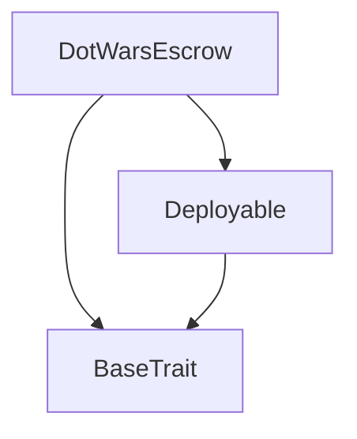
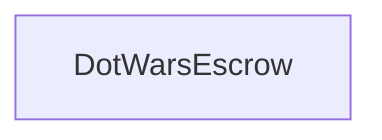

# Tact compilation report
Contract: DotWarsEscrow
BoC Size: 1567 bytes

## Structures (Structs and Messages)
Total structures: 21

### DataSize
TL-B: `_ cells:int257 bits:int257 refs:int257 = DataSize`
Signature: `DataSize{cells:int257,bits:int257,refs:int257}`

### SignedBundle
TL-B: `_ signature:fixed_bytes64 signedData:remainder<slice> = SignedBundle`
Signature: `SignedBundle{signature:fixed_bytes64,signedData:remainder<slice>}`

### StateInit
TL-B: `_ code:^cell data:^cell = StateInit`
Signature: `StateInit{code:^cell,data:^cell}`

### Context
TL-B: `_ bounceable:bool sender:address value:int257 raw:^slice = Context`
Signature: `Context{bounceable:bool,sender:address,value:int257,raw:^slice}`

### SendParameters
TL-B: `_ mode:int257 body:Maybe ^cell code:Maybe ^cell data:Maybe ^cell value:int257 to:address bounce:bool = SendParameters`
Signature: `SendParameters{mode:int257,body:Maybe ^cell,code:Maybe ^cell,data:Maybe ^cell,value:int257,to:address,bounce:bool}`

### MessageParameters
TL-B: `_ mode:int257 body:Maybe ^cell value:int257 to:address bounce:bool = MessageParameters`
Signature: `MessageParameters{mode:int257,body:Maybe ^cell,value:int257,to:address,bounce:bool}`

### DeployParameters
TL-B: `_ mode:int257 body:Maybe ^cell value:int257 bounce:bool init:StateInit{code:^cell,data:^cell} = DeployParameters`
Signature: `DeployParameters{mode:int257,body:Maybe ^cell,value:int257,bounce:bool,init:StateInit{code:^cell,data:^cell}}`

### StdAddress
TL-B: `_ workchain:int8 address:uint256 = StdAddress`
Signature: `StdAddress{workchain:int8,address:uint256}`

### VarAddress
TL-B: `_ workchain:int32 address:^slice = VarAddress`
Signature: `VarAddress{workchain:int32,address:^slice}`

### BasechainAddress
TL-B: `_ hash:Maybe int257 = BasechainAddress`
Signature: `BasechainAddress{hash:Maybe int257}`

### Deploy
TL-B: `deploy#946a98b6 queryId:uint64 = Deploy`
Signature: `Deploy{queryId:uint64}`

### DeployOk
TL-B: `deploy_ok#aff90f57 queryId:uint64 = DeployOk`
Signature: `DeployOk{queryId:uint64}`

### FactoryDeploy
TL-B: `factory_deploy#6d0ff13b queryId:uint64 cashback:address = FactoryDeploy`
Signature: `FactoryDeploy{queryId:uint64,cashback:address}`

### OpenMatch
TL-B: `open_match#4f50454e matchId:uint256 host:address stake:coins rakeBps:uint16 = OpenMatch`
Signature: `OpenMatch{matchId:uint256,host:address,stake:coins,rakeBps:uint16}`

### SetGuest
TL-B: `set_guest#47534554 matchId:uint256 guest:address = SetGuest`
Signature: `SetGuest{matchId:uint256,guest:address}`

### Deposit
TL-B: `deposit#4445504f matchId:uint256 = Deposit`
Signature: `Deposit{matchId:uint256}`

### Settle
TL-B: `settle#53544c45 matchId:uint256 outcome:uint8 = Settle`
Signature: `Settle{matchId:uint256,outcome:uint8}`

### Refund
TL-B: `refund#52464e44 matchId:uint256 = Refund`
Signature: `Refund{matchId:uint256}`

### RefundOne
TL-B: `refund_one#52464e31 matchId:uint256 who:address = RefundOne`
Signature: `RefundOne{matchId:uint256,who:address}`

### MatchData
TL-B: `_ exists:bool host:address guest:address stake:coins rakeBps:uint16 hostPaid:bool guestPaid:bool settled:bool = MatchData`
Signature: `MatchData{exists:bool,host:address,guest:address,stake:coins,rakeBps:uint16,hostPaid:bool,guestPaid:bool,settled:bool}`

### DotWarsEscrow$Data
TL-B: `_ oracle:address treasury:address matches:dict<uint256, ^MatchData{exists:bool,host:address,guest:address,stake:coins,rakeBps:uint16,hostPaid:bool,guestPaid:bool,settled:bool}> = DotWarsEscrow`
Signature: `DotWarsEscrow{oracle:address,treasury:address,matches:dict<uint256, ^MatchData{exists:bool,host:address,guest:address,stake:coins,rakeBps:uint16,hostPaid:bool,guestPaid:bool,settled:bool}>}`

## Get methods
Total get methods: 3

## matchInfo
Argument: id

## oracle
No arguments

## treasury
No arguments

## Exit codes
* 2: Stack underflow
* 3: Stack overflow
* 4: Integer overflow
* 5: Integer out of expected range
* 6: Invalid opcode
* 7: Type check error
* 8: Cell overflow
* 9: Cell underflow
* 10: Dictionary error
* 11: 'Unknown' error
* 12: Fatal error
* 13: Out of gas error
* 14: Virtualization error
* 32: Action list is invalid
* 33: Action list is too long
* 34: Action is invalid or not supported
* 35: Invalid source address in outbound message
* 36: Invalid destination address in outbound message
* 37: Not enough Toncoin
* 38: Not enough extra currencies
* 39: Outbound message does not fit into a cell after rewriting
* 40: Cannot process a message
* 41: Library reference is null
* 42: Library change action error
* 43: Exceeded maximum number of cells in the library or the maximum depth of the Merkle tree
* 50: Account state size exceeded limits
* 128: Null reference exception
* 129: Invalid serialization prefix
* 130: Invalid incoming message
* 131: Constraints error
* 132: Access denied
* 133: Contract stopped
* 134: Invalid argument
* 135: Code of a contract was not found
* 136: Invalid standard address
* 138: Not a basechain address
* 2230: paid
* 7604: auth
* 14922: outcome
* 19671: locked
* 21516: oracle
* 29117: value
* 35695: stake
* 38048: open
* 40440: guest
* 46519: match
* 50521: rake
* 51614: lock
* 60283: host

## Trait inheritance diagram

## Contract dependency diagram

